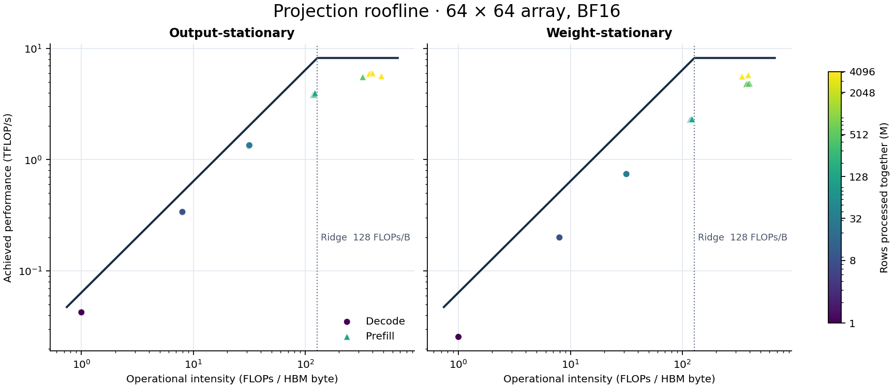
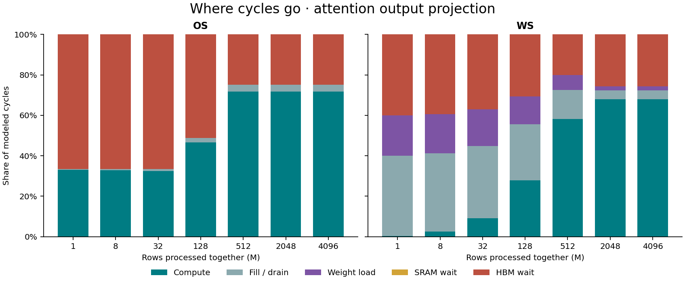
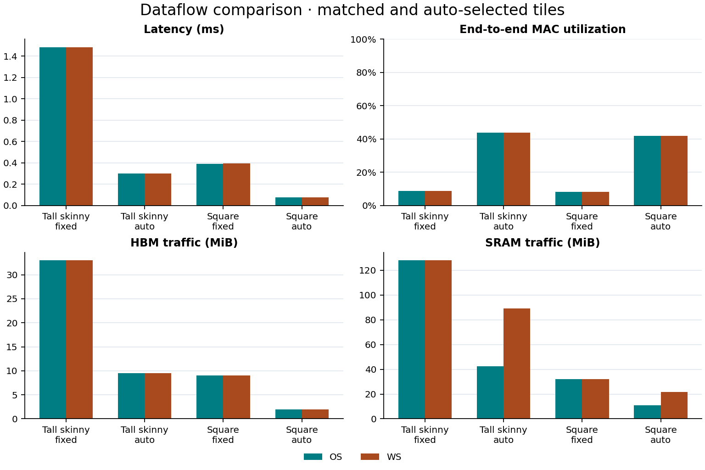
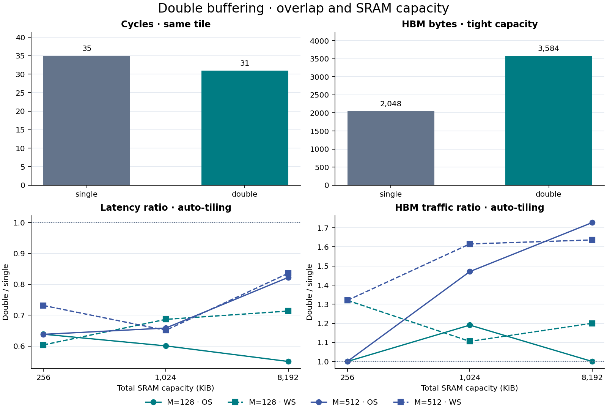
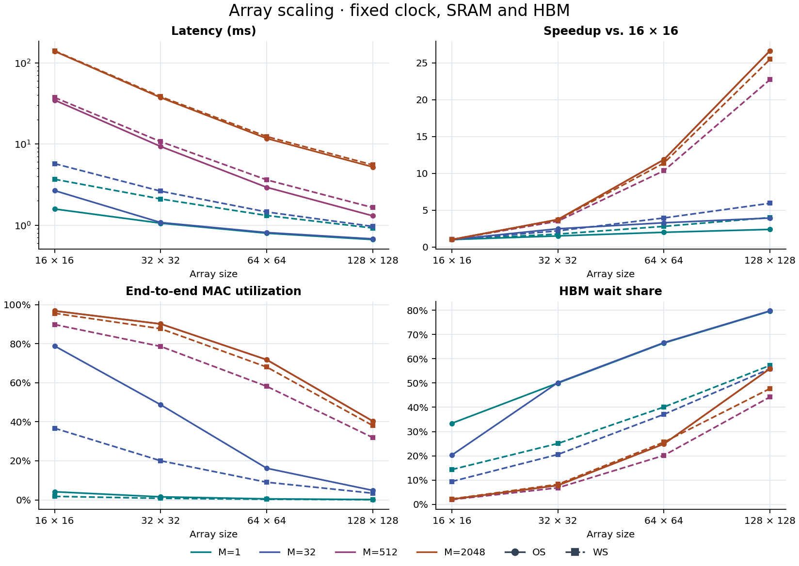

# TenSys evaluation

The full suite ran 138 GEMM cases across synthetic accelerator configurations. The BF16 baseline has a 64 × 64 array, one MAC per PE per cycle, a 1 GHz clock, 8 MiB unified SRAM, 2,048 GB/s in each SRAM direction, and 64 GB/s HBM with 200 setup cycles. Its peak is 8.192 TFLOP/s and its ridge point is 128 FLOPs per HBM byte. The Transformer cases use Llama 3.1 8B projection dimensions. [Model guide](model.md) · [Model dimensions](https://github.com/meta-llama/llama-models/blob/main/models/sku_list.py#L2546)

[Raw simulator JSON](results/raw.json) · [Metrics CSV](results/metrics.csv) · [Run manifest](results/manifest.json)

## Prefill and decode

Every projection and both dataflows fell below the ridge at the sampled M values through 128 and above it from 512 onward. For the output-stationary attention output projection, intensity rose from 1.0 FLOPs per HBM byte at M=1 to 372.4 at M=512. HBM wait dropped from 66.5% to 24.9% of modeled cycles, while throughput rose from 0.042 to 5.88 TFLOP/s.

For weight-stationary execution at M=1, HBM wait consumed 40.1% of cycles, fill and drain consumed 39.6%, and weight loading consumed another 20.0%. The operand-traffic ceiling describes the low-intensity regime, while the cycle breakdown shows how array overhead reduces achieved performance further.





## Weight-stationary and output-stationary

The two dataflows differed by less than 0.2% in elapsed cycles on the tall-skinny and square cases, with either matched tiles or auto-tiling. Tile selection drove most of the latency change. It reduced HBM traffic from 33 to 9.5 MiB on the tall-skinny GEMM and from 9 to 2 MiB on the square GEMM. Output-stationary then ran 4.95× and 5.03× faster, respectively, than its fixed-tile runs.

With auto-tiling on the tall-skinny shape, output-stationary used 42.5 MiB of SRAM traffic and weight-stationary used 89 MiB. On the square shape, the totals were 11 MiB and 21.5 MiB. Weight-stationary wrote partials after each internal reduction wave, increasing SRAM traffic while both flows moved the same number of HBM bytes.



## Double buffering

With both modes using the same tile, double buffering hid four DMA cycles and reduced total time from 35 to 31 cycles. Both modes moved 44 HBM bytes. The tight-capacity control halved the bank budget from 896 to 448 bytes. The selected tile changed from 16 × 4 × 32 to 4 × 4 × 32, and HBM traffic grew from 2,048 to 3,584 bytes.

Double buffering reduced elapsed cycles by 16–45% across the attention projection capacity sweep. At M=512 with 8 MiB SRAM, output-stationary latency decreased from 2.92 ms to 2.40 ms while HBM traffic increased from 44 to 76 MiB. In that case, the extra traffic was outweighed by overlapping input DMA with array work.



## Array scaling

Moving from 16 × 16 to 128 × 128 increased the number of PEs by 64×. Output-stationary execution sped up by 2.38× at M=1 and by 26.65× at M=2048. For M=1, HBM wait rose from 33.4% to 79.6% of total cycles and end-to-end MAC utilization fell from 4.15% to 0.15%. For M=2048, end-to-end utilization on the largest array was 40.3%, with HBM wait accounting for 55.9% of cycles. Weight-stationary reached 3.99× and 25.49× speedups at those two M values.



## Reproduction and validation

Run the suite from the repo root after building the Release executable.

```sh
PYTHONPATH=python python -m tensys_dse --sim build/release/tensys --suite all --out reports/latest
```

The suite completed in about 2.4 seconds on arm64 macOS. A standalone run of the largest bundled case, a weight-stationary FFN up projection at (4096, 14336, 4096), took about 25 ms. Both are host runtimes for running the simulator. The manifest records the exact measurements.

The Release build passed 12 C++ tests and seven Python tests. The grouped simulator and enumerated trace agree on their shared fixtures, including single and double buffering, scratchpad limits, and incomplete tiles. All 138 exported cases satisfied cycle and traffic accounting, and achieved performance stayed within its theoretical roofline ceiling in each case.
