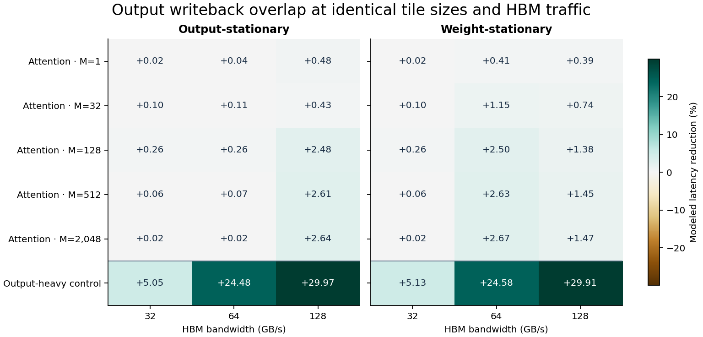

# Event-driven HBM writeback

The writeback scheduler lets the array start another output tile while a finished tile drains to HBM. In **36 matched comparisons**, it reduced modeled latency in every case with identical HBM and SRAM traffic. The median reduction was **0.45%** overall. The attention projection cases had a **0.33%** median reduction, and the output-heavy control reached **29.97%**.

[Raw simulator results](writeback-results/raw.json) · [Metrics CSV](writeback-results/metrics.csv) · [Run manifest](writeback-results/manifest.json)



## Model

The baseline prefetches the next input tile during array execution and blocks on each complete output write. The writeback policy allocates a bank when an output tile starts, holds it through its full reduction, and releases it when its final HBM write completes. The other accumulator bank can hold a second output tile during that write. Both policies use the same double-buffered memory capacity, tile mapping, per-tile array cost, transfer rates, and operand-reuse rules.

One bidirectional DMA lane serves reads and writes. The scheduler jumps to the next completion, retires all operations due at that cycle, then starts eligible array work. DMA prioritizes the input needed by an idle array, a write that frees a bank for an array with ready input, a prefetch one tile ahead, and finally the oldest queued write. Only a completed output tile queues a write. A layer finishes when its final output write completes.

The scheduler measures hidden cycles as the intersection of array and DMA activity. Exposed wait is assigned to input wait, accumulator-bank wait, or final writeback drain. Missing inputs take priority over bank availability when assigning a wait interval. Hidden DMA and exposed wait sum to total DMA service. Each layer starts with empty SRAM. [TenSys model](model.md)

## Fixed-tile comparison

The BF16 experiment uses 64 × 64 PEs, a 1 GHz clock, 8 MiB of unified SRAM, 2,048 GB/s SRAM read and write bandwidth, and 200 setup cycles per HBM transfer. It compares both dataflows at 32, 64, and 128 GB/s HBM with M → N → K traversal. The attention output projection has N = K = 4,096 and M = 1, 32, 128, 512, or 2,048. Its tile is (min(M,128), 256, 512). The output-heavy control has shape (512, 1024, 128) and tile (128, 256, 128).

| Workload | Dataflow | HBM | Baseline cycles | Writeback cycles | Reduction |
| --- | --- | ---: | ---: | ---: | ---: |
| Attention, M=1 | OS | 32 GB/s | 1,084,288 | 1,084,056 | 0.02% |
| Attention, M=2,048 | WS | 64 GB/s | 21,487,816 | 20,914,576 | 2.67% |
| Output-heavy control | OS | 32 GB/s | 114,896 | 109,096 | 5.05% |
| Output-heavy control | OS | 128 GB/s | 61,256 | 42,896 | 29.97% |

The advantage depends on how much output traffic can overlap with array work. At 128 GB/s, the output-heavy OS case hid 18,360 output DMA cycles and had zero accumulator-bank wait. At 32 GB/s, the same case hid 5,800 output DMA cycles and waited 56,888 cycles for a bank. Input traffic and bank occupancy limit the gain at lower bandwidth.

The hand-calculated two-tile fixture isolates the mechanism. Both policies move 44 HBM bytes. The baseline completes in 31 cycles and the new schedule completes in 25. The six-cycle difference is the first output write overlapping the entire second array step.

Replay of 75,648 timeline events across the benchmark reproduced the exported service times, wait intervals, and tensor traffic. Every array step had its inputs ready, and each bank remained occupied through completion of its output write.

## Reproduce the run

After building the Release executable, run the comparison CLI with double-buffered hardware. The optional timeline contains start and finish events for array steps, input fetches, and output writes. Cycle counts restart at zero per layer.

```sh
build/release/tensys dma-compare \
  --hardware examples/hardware-small.json --workload examples/verify.json \
  --dataflow ws --tile 5,7,6 --order nmk --timeline build/writeback.ndjson

PYTHONPATH=python python -m tensys_dse --sim build/release/tensys \
  --suite writeback --out reports/writeback
```

The JSON records one shared mapping per layer and metrics under `baseline` and `writeback`. A negative `latency_change_pct` means a reduction. The timeline uses zero-based tile coordinates and bank IDs. Input fetch events use a null accumulator bank.
